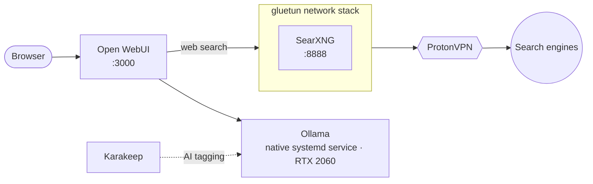

# Ollama + Open WebUI + SearXNG

> Local LLM stack with private web search

| | |
|---|---|
| **Host** | ShineoriServer |
| **Category** | AI |
| **Status** | 🟢 running |
| **Exposed?** | Open WebUI through Cloudflare Tunnel (usually spun down); SearXNG LAN only, with its traffic leaving through ProtonVPN |
| **GPU** | RTX 2060 |

Compose file: [`stacks/ollama-stack/`](https://github.com/shineori/homelab/tree/main/stacks/ollama-stack)

## Why I run it

I wanted to run AI models on my own hardware, so my prompts never leave my network. Open WebUI gives it a ChatGPT-style interface, and SearXNG lets the models search the web without the search engines seeing my home IP.

## Architecture

| Piece | Job |
|---|---|
| **Ollama** | Runs the models on the GPU. It's installed **natively** (a systemd service on port 11432), not in Docker, so it has direct access to the GPU drivers. |
| **Open WebUI** | The chat interface. Reaches Ollama through `host.docker.internal`, which always means "this machine" even if its IP changes. |
| **SearXNG** | A private meta-search engine. It runs **inside gluetun's network stack**, so with no VPN it has no internet at all. |
| **Shared with [Karakeep](karakeep.md)** | Karakeep uses the same Ollama for tagging bookmarks |

## Security decisions

| Decision | Why |
|---|---|
| **Local models only** | Prompts and documents stay on my hardware |
| **SearXNG behind a VPN with a kill switch** | Search engines see a ProtonVPN address, never my home IP |
| **VPN only for SearXNG, not the whole laptop** | Keeps everything else on the laptop on a normal connection (see the troubleshooting log for why that matters) |
| **No SSO on Open WebUI** | It's spun down most of the time, so I skipped connecting it to [Authentik](authentik.md) |
| **Secrets in a git-ignored `.env`** | `WEBUI_SECRET_KEY` and the ProtonVPN login |

## Setup notes

1. Install Ollama natively with the NVIDIA driver; it listens on port 11432
2. Fill `.env` with `WEBUI_SECRET_KEY` and the ProtonVPN OpenVPN credentials
3. `docker compose up -d`; Open WebUI at `http://<LAN_IP>:3000`, SearXNG at `http://<LAN_IP>:8888`
4. Web search is pre-configured to `http://gluetun:8080/search?q=<query>`
5. Pull models with `ollama pull <model>`

## Troubleshooting log

| Date | Problem | Root cause | Fix |
|---|---|---|---|
| 2026-10-11 | The laptop lost internet: Docker pulls failed with DNS timeouts | A second, **host-wide** ProtonVPN WireGuard tunnel had stopped passing traffic, and it was capturing everything. SearXNG already had its own VPN through gluetun, so this was a VPN inside a VPN. | Took the host-wide tunnel down and disabled it at boot. SearXNG stays private through gluetun. ([details](../infrastructure/migration.md#troubleshooting-log)) |

## What I'd harden next

- [ ] Pin Open WebUI (`:main`), SearXNG and gluetun instead of floating tags
- [ ] Bind Open WebUI's port to the LAN IP instead of every interface
- [ ] Back up Open WebUI's chat history volume

## What I learned

- **GPU workloads:** why the model server runs natively while the web apps run in containers
- **Per-app VPN routing** with gluetun, instead of tunneling a whole machine
- **WireGuard routing:** `ip route` can look normal while policy rules (`ip rule`) send everything into a dead tunnel
