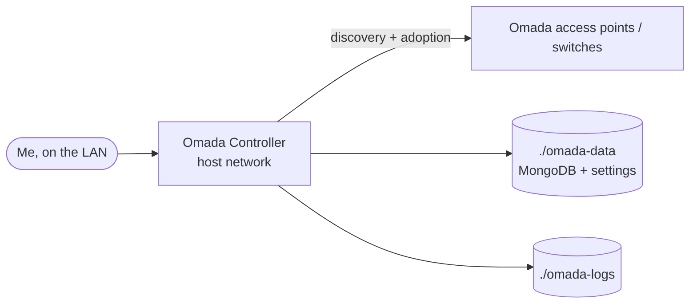

# Omada Controller

> Manages TP-Link Omada network gear

| | |
|---|---|
| **Host** | ShiNAS |
| **Category** | Networking & monitoring |
| **Status** | ⏸️ on demand (started only when I need it) |
| **Exposed?** | LAN only |
| **Version** | 5.15 (`mbentley/omada-controller`) |

Compose file: [`stacks/omada-controller/`](https://github.com/shineori/homelab/tree/main/stacks/omada-controller)

## Why I run it

My network gear is managed from an Omada controller. Instead of buying TP-Link's hardware controller, I run the software version in Docker and start it only when I need to change something. The access points keep working without it.

## Architecture

## Security decisions

| Decision | Why |
|---|---|
| **LAN only, on demand** | A controller that can reconfigure the whole network shouldn't be reachable from outside, or running when nobody's using it |
| **`network_mode: host`** | Device discovery uses broadcast traffic on the local network, which Docker's default bridge network blocks |
| **`stop_grace_period: 60s`** | Gives the built-in MongoDB time to shut down cleanly, so the database isn't corrupted on stop |

## Setup notes

1. `docker compose up -d` and wait a few minutes on first start (it initialises MongoDB)
2. Open the controller's web page on the NAS's address and run the setup wizard
3. Adopt the devices. They remember the controller's address, which is why it can't easily move to another machine without re-adopting them.
4. Moved from `/opt/omada` into the standard `~/docker` layout during the consolidation

## Troubleshooting log

| Date | Problem | Root cause | Fix |
|---|---|---|---|
| — | Nothing logged yet | | |

## What I'd harden next

- [ ] Back up `./omada-data` (or use the controller's own backup export) before any upgrade
- [ ] Remove the two unused named volumes declared at the bottom of the compose file (the stack uses folders instead)

## What I learned

- **Why some apps need host networking:** Layer 2 discovery doesn't cross Docker's bridge network
- **Clean shutdowns matter for databases** inside containers
- **Control planes vs data planes:** the access points keep forwarding traffic while the controller is off
