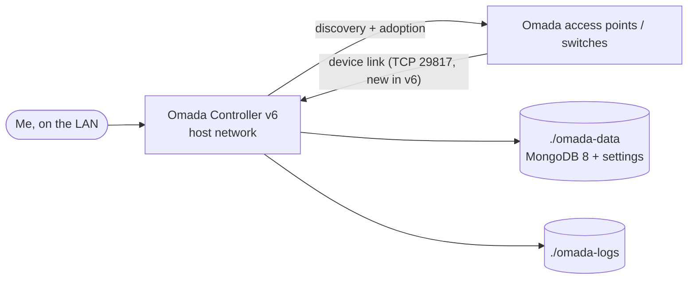

# Omada Controller

> Manages TP-Link Omada network gear

| | |
|---|---|
| **Host** | ShineoriServer |
| **Category** | Networking & monitoring |
| **Status** | ⏸️ on demand (started only when I need it) |
| **Exposed?** | LAN only |
| **Version** | 6.3.0.111 (`mbentley/omada-controller`, pinned) |

Compose file: [`stacks/omada-controller/`](https://github.com/shineori/homelab/tree/main/stacks/omada-controller)

## Why I run it

My network gear is managed from an Omada controller. Instead of buying TP-Link's hardware controller, I run the software version in Docker and start it only when I need to change something. The access points keep working without it.

It used to live on the NAS. I moved it to ShineoriServer along with the other apps that don't need the NAS disks, since the NAS is short on RAM.

## Architecture



## Security decisions

| Decision | Why |
|---|---|
| **LAN only, on demand** | A controller that can reconfigure the whole network shouldn't be reachable from outside, or running when nobody's using it |
| **`network_mode: host`** | Device discovery uses broadcast traffic on the local network, which Docker's default bridge network blocks. It also means new ports like v6's 29817 work without any compose change. |
| **`stop_grace_period: 60s`** | Gives the built-in MongoDB time to shut down cleanly, so the database isn't corrupted on stop |
| **Pinned exact version** | `latest` on this image stays on v5 on purpose, so pinning is the only way to get v6, and upgrades happen on my schedule |
| **`ulimits: nofile 65536`** | The database is thousands of small files. Docker's default limit of 1,024 open files crashed the MongoDB upgrade (see the troubleshooting log). |

## Setup notes

1. `docker compose up -d` and wait a few minutes on first start (it initialises MongoDB)
2. Open the controller's web page on the server's address (port 8043) and run the setup wizard
3. Adopt the devices. They remember the controller's address, so moving the controller to another machine means the devices have to find it again.
4. Moved from `/opt/omada` into the standard `~/docker` layout during the consolidation, then from the NAS to ShineoriServer
5. **Upgrading v5 to v6:** v6 needs MongoDB 8 instead of 3.6. With the controller stopped and its data backed up, run the image author's one-shot migration container, then change the tag:

```bash
docker compose down
sudo tar -czf ~/omada-data-backup.tar.gz -C ~/docker/omada omada-data
docker run -it --rm --ulimit nofile=65536:65536 \
  -v ~/docker/omada/omada-data:/opt/tplink/EAPController/data \
  mbentley/omada-controller:mongodb-upgrade-3.6-to-8
# set image: mbentley/omada-controller:6.3.0.111, then
docker compose up -d
```

TP-Link's own Linux download (a `.tar.gz` installer that needs Java 17, MongoDB and jsvc on the host) is for bare-metal installs. It isn't needed with Docker.

## Troubleshooting log

| Date | Problem | Root cause | Fix |
|---|---|---|---|
| 2026-10-28 | The MongoDB 3.6 → 8 migration crashed at the 4.0 step with `WT_PANIC` and an invariant failure. It rolled itself back. | The real line in `mongodb_upgrade.log`: **`Too many open files`**. The repair step opens every collection and index file at once (about 6,500), and Docker's default limit is 1,024. Normal running never hit it because files are opened a few at a time. | Reran the migration with `--ulimit nofile=65536:65536`. Every step from 3.6 to 8.0 passed. Added the same limit to the compose file. |
| 2026-10-28 | v6 showed a "Port Access Required" popup for TCP 29817 | v6 added a new port for devices. The notice appears for everyone after upgrading. | Nothing to do: host networking exposes it, and a test connection from another LAN machine succeeded |

## What I'd harden next

- [x] Back up `./omada-data` (and export the controller's own backup) before any upgrade ✅ *Done for the v6 upgrade*
- [ ] Remove the two unused named volumes declared at the bottom of the compose file (the stack uses folders instead)
- [ ] Delete the old copy of the stack left on the NAS so the v5 controller can't be started there by accident
- [ ] Clean up the migration leftovers (`mongodb-preupgrade.tar` and the upgrade logs) once v6 has been stable for a while

## What I learned

- **Why some apps need host networking:** Layer 2 discovery doesn't cross Docker's bridge network
- **Clean shutdowns matter for databases** inside containers
- **Control planes vs data planes:** the access points keep forwarding traffic while the controller is off
- **Databases upgrade in steps.** MongoDB can't jump from 3.6 to 8; it has to pass through 4.0, 4.2, 4.4, 5.0, 6.0 and 7.0
- **A backtrace says where, the log says why.** The crash dump only showed the function that failed. The cause was one plain-English line further up the log.
- **Container limits are real limits.** `ulimit` inside a container is set by Docker, not by the app, and it can break things that work fine at normal load
- **`latest` doesn't always mean newest.** This image keeps `latest` on v5 so a major upgrade can't happen by surprise
