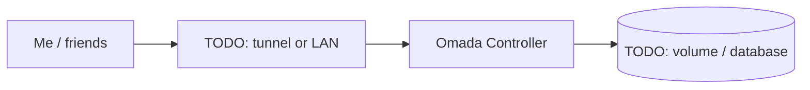

# Omada Controller

> Manages TP-Link Omada network gear

| | |
|---|---|
| **Host** | ShiNAS |
| **Category** | Networking & monitoring |
| **Status** | ⏸️ on demand (started only when I need it) |
| **Exposed?** | LAN only |

Compose file: [`stacks/omada-controller/`](https://github.com/shineori/homelab/tree/main/stacks/omada-controller)

## Why I run it

TODO: one or two sentences. What problem does this solve for you?

## Architecture

## Setup notes

- Moved from /opt/omada into the consolidated ~/docker layout

TODO: the steps you'd need to rebuild this from scratch.

## Troubleshooting log

| Date | Problem | Root cause | Fix |
|---|---|---|---|
| TODO | | | |

## What I learned

TODO: the skill this proves (great for interviews).
