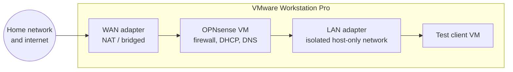

# OPNsense router lab

> Virtual OPNsense router in VMware Workstation Pro, rehearsal for a NUC router

| | |
|---|---|
| **Host** | Windows PC |
| **Category** | Security labs |
| **Status** | 🟢 lab complete (still experimenting) |
| **Exposed?** | No. VMware virtual networks only |

Not a Docker stack (see setup notes below).

## Why I run it

I want to replace my home router with a custom one: a small NUC running OPNsense. Before buying hardware, I learned OPNsense in a virtual machine, where a mistake costs nothing and doesn't take my home internet down. The core lab is finished: the virtual router hands out addresses, resolves DNS and filters traffic for a client behind it. I keep it around as a sandbox for trying new ideas before they ever touch the real network.

## Architecture

- **WAN side:** gets its address from VMware, the same way a real router gets one from the ISP
- **LAN side:** an isolated virtual network with VMware's own DHCP turned off, so OPNsense is the only thing handing out addresses
- **Test client:** a normal VM whose only network is the lab LAN, so all of its traffic has to go through OPNsense

## Security decisions

| Decision | Why |
|---|---|
| **Practice in a VM first** | Routing and firewall mistakes stay inside the lab instead of cutting off my real network |
| **Virtual networks only** | The lab router doesn't sit in front of any real device |
| **Isolated LAN network** | The test client can only reach the outside world through OPNsense, so every rule I write actually gets tested |
| **Web UI only on the LAN side** | The admin page should never be reachable from WAN, same as I'll want on the real router |
| **Snapshot before big changes** | A VMware snapshot is a free undo button if a rule locks me out |

## Setup notes

1. Create the OPNsense VM in VMware Workstation Pro with two network adapters: one for WAN (NAT) and one on a custom host-only network for LAN
2. Turn off VMware's DHCP on the LAN network so it doesn't fight with OPNsense
3. Install OPNsense, then assign interfaces from the console (match each adapter's MAC address to WAN or LAN)
4. Finish the setup wizard from the web UI on the LAN side, and change the default password
5. Put a test client VM on the LAN network and confirm it gets an address, DNS and internet through OPNsense
6. Practice firewall rules (allow, block, logging), DHCP static mappings and DNS overrides, checking each one from the client
7. Take a snapshot once everything works, so experiments can always roll back to a known-good router

## Troubleshooting log

| Date | Problem | Root cause | Fix |
|---|---|---|---|
| Lab build | WAN and LAN looked swapped after install | The console assigned interfaces in a different order than I expected | Re-assigned interfaces by matching MAC addresses in VMware to the ones OPNsense showed |
| Lab build | Test client got an address from the wrong place | VMware's built-in DHCP was still on for the LAN network | Turned off DHCP for that network in VMware's Virtual Network Editor |

## What I'd harden next

- [ ] Build VLANs (for example, separate networks for servers, personal devices and IoT) and firewall rules between them
- [ ] Try IDS/IPS (Suricata) in the lab to see what it catches and what it costs in performance
- [ ] Export the finished config so it can be restored onto the NUC instead of rebuilt by hand
- [ ] Decide on NUC hardware (at least two network ports) once the virtual setup does everything I want

## What I learned

- **Rehearse risky changes:** a VM lab is the cheapest place to make networking mistakes, and snapshots make them free
- **Interfaces are identity:** most "nothing works" moments came down to which adapter OPNsense thought was WAN and which was LAN
- **Only one DHCP server per network:** two servers answering on the same network causes confusing, random-looking problems
- **Firewall rules read top to bottom:** the first matching rule wins, so order matters as much as the rules themselves
- **Default deny is a mindset:** start from "block everything" and open only what a network actually needs
- **How a router really works:** WAN, LAN, NAT, DHCP and DNS stopped being words on a settings page and became pieces I set up and tested myself
