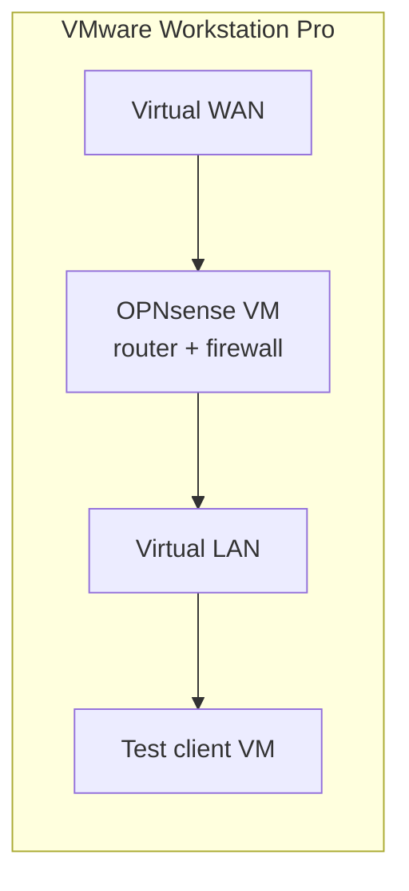

# OPNsense router lab

> Virtual OPNsense router in VMware Workstation Pro, rehearsal for a NUC router

| | |
|---|---|
| **Host** | Windows PC |
| **Category** | Security labs |
| **Status** | 🟡 in progress |
| **Exposed?** | No. VMware virtual networks only |

Not a Docker stack (see setup notes below).

## Why I run it

I want to replace my home router with a custom one: a small NUC running OPNsense. Before buying hardware, I'm learning OPNsense in a virtual machine, where a mistake costs nothing and doesn't take my home internet down.

## Architecture

## Security decisions

| Decision | Why |
|---|---|
| **Practice in a VM first** | Routing and firewall mistakes stay inside the lab instead of cutting off my real network |
| **Virtual networks only** | The lab router doesn't sit in front of any real device yet |

## Setup notes

1. Create an OPNsense VM in VMware Workstation Pro with two network adapters (WAN and LAN)
2. Put a test client VM on the LAN side
3. Practice firewall rules, DHCP and DNS before doing it for real on hardware

## Troubleshooting log

| Date | Problem | Root cause | Fix |
|---|---|---|---|
| — | Nothing logged yet | | |

## What I'd harden next

- [ ] Build VLANs (for example, separate networks for servers, personal devices and IoT) and firewall rules between them
- [ ] Decide on NUC hardware once the virtual setup works the way I want

## What I learned

- **Rehearse risky changes:** a VM lab is the cheapest place to make networking mistakes
- *(More to add as the lab grows.)*
