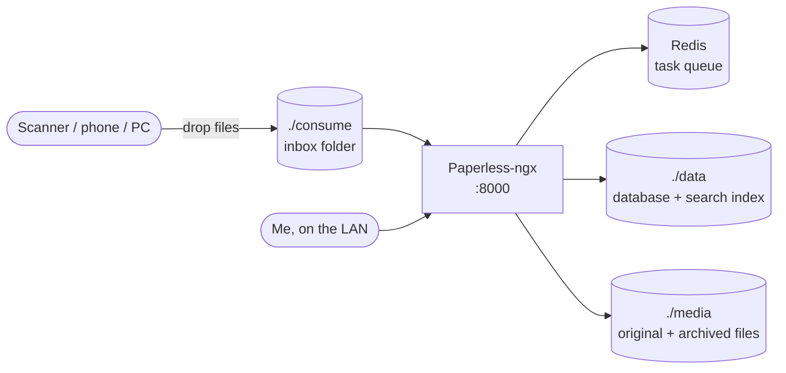

# Paperless-ngx

> Scans, OCRs and organizes documents so they're searchable

| | |
|---|---|
| **Host** | ShineoriServer |
| **Category** | Apps |
| **Status** | 🟢 running |
| **Exposed?** | LAN only (not published through the tunnel) |
| **Version** | 3.3.4 (pinned) |

Compose file: [`stacks/paperless/`](https://github.com/shineori/homelab/tree/main/stacks/paperless)

## Why I run it

Paper documents and PDFs used to pile up in folders where I could never find them. Paperless turns every scan into searchable text (OCR), tags it, and lets me find any document by typing a word that's in it.

It started on the NAS. I moved it to ShineoriServer, where there's plenty of RAM for OCR jobs, and upgraded it on the way.

## Architecture

| Folder | Holds |
|---|---|
| `./consume` | The inbox: anything dropped here is imported, OCR'd and filed automatically |
| `./media` | The documents themselves, original and searchable-PDF versions |
| `./data` | The database (SQLite) and search index |
| `./export` | Where Paperless's own export tool writes a full, portable backup |

## Security decisions

| Decision | Why |
|---|---|
| **LAN only** | These are personal documents. There's no reason for them to be reachable from the internet. |
| **Admin credentials and secret key kept out of git** | Redacted in the repo, including the admin username |
| **Pinned image** | Upgrades on my schedule |

## Setup notes

1. Set `PAPERLESS_SECRET_KEY`, the admin user and password, time zone and OCR language
2. `docker compose up -d`, then log in at `http://<LAN_IP>:8000`
3. Drop files into `./consume` (or upload in the web UI); set up tags, correspondents and document types
4. Matching rules can tag new documents automatically
5. **Moving it:** the whole app lives in its folder (bind mounts, no named volumes), so moving to another server is stop, copy the folder, `docker compose up -d`

## Troubleshooting log

| Date | Problem | Root cause | Fix |
|---|---|---|---|
| 2026-10-11 | Down along with other NAS apps | The NAS was overloaded by Immich ([diagnosis](immich.md#troubleshooting-log)) | Fixed the overload; Paperless is back up |
| 2026-10-28 | Moved from the NAS to ShineoriServer and upgraded from 3.2.1 to 3.3.4 | Planned move | Came up healthy on the new host; the NAS copy is gone |

## What I'd harden next

- [ ] **Add it to the nightly encrypted backup.** Scanned documents are as irreplaceable as photos ([roadmap](../infrastructure/backups.md#roadmap-to-full-3-2-1)). In progress: joining ShineoriServer's append-only backup to the NAS.
- [ ] Move the admin password and secret key out of the compose file into a git-ignored `.env`
- [ ] Pin the Redis image (`redis:7` is a floating tag)

## What I learned

- **OCR pipelines:** a watched "consume" folder turns a scanner into an automatic filing system
- **The difference between running and protected:** uptime doesn't protect irreplaceable data, backups do
- **Bind mounts make moves easy:** with everything in one folder, moving servers is just a folder copy
