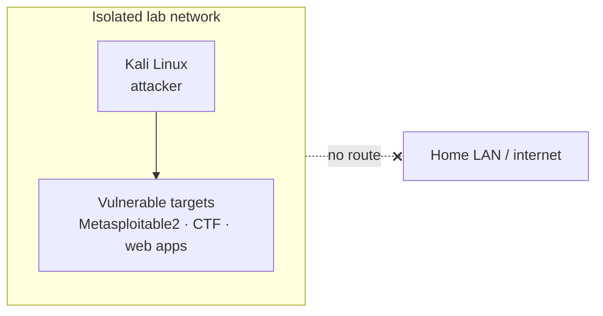

# Pentesting lab

> Attacker/target lab for practicing offensive security legally

| | |
|---|---|
| **Host** | Windows PC |
| **Category** | Security labs |
| **Status** | 🟢 running |
| **Exposed?** | No. Isolated lab networks, not reachable from the internet or my home LAN |

Not a Docker stack (see setup notes below).

## Why I run it

I'm studying cybersecurity, and the only legal way to practice attacking systems is against systems I own. This lab gives me intentionally vulnerable targets on isolated networks, so I can practice reconnaissance and exploitation without touching anything that isn't mine.

## Architecture

## Security decisions

| Decision | Why |
|---|---|
| **Only targets I own** | Every machine in the lab is mine and set up for this purpose, so all testing is authorized |
| **Isolated networks** | Intentionally vulnerable machines must never be reachable from my real network or the internet |
| **Scoped and documented exercises** | Each exercise has a defined target and a write-up, the same habits a real engagement requires |
| **Moved off the NAS** | Attack tools and vulnerable targets don't belong on the server holding my passwords and photos |

## Setup notes

1. **v1:** a Docker lab on ShiNAS, with an isolated Kali attacker container and a Metasploitable2 target
2. **v2 (now):** moved to my Windows machines. The attacker images on the NAS were removed in October 2026.
3. Targets: Metasploitable2, plus segmented CTF and web-app practice targets

## Troubleshooting log

| Date | Problem | Root cause | Fix |
|---|---|---|---|
| 2026-10 | Attacker images were still on the NAS after the lab moved | Leftovers from v1 | Removed them, so the NAS only runs services |

## What I'd harden next

- [ ] Write up individual exercises (target, steps, findings, fix) as separate pages
- [ ] Snapshot the targets so each exercise starts from a clean state

## What I learned

- **Authorization and scope first:** knowing what you're allowed to test comes before any tool
- **Isolation design:** vulnerable machines need a network with no way out
- **Separating roles:** a production server and an attack lab shouldn't share a machine
