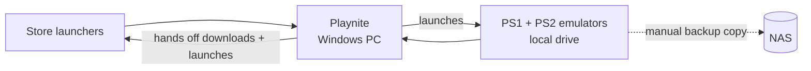

# Playnite

> One game library on my PC for every store launcher and my emulators

| | |
|---|---|
| **Host** | Windows PC |
| **Category** | Apps |
| **Status** | 🟢 running |
| **Exposed?** | No. It's a desktop app, not a network service. |
| **Version** | `10.63` |

No compose file, because Playnite is a Windows app rather than a container.
Upstream: [JosefNemec/Playnite](https://github.com/JosefNemec/Playnite)

## Why I run it

My games are split across several launchers, plus emulators, and I wanted a single library for all of them. I first tried a self-hosted game server, Gameyfin, but it gives you download pages rather than a way to launch games, and I want to download and manage my games on my PC anyway. Playnite does what I actually needed, so it replaced Gameyfin completely.

## Architecture

| Piece | Job |
|---|---|
| Playnite | The library: art, metadata and launching |
| Store launchers | Still do the downloading, to the folder set in each launcher |
| DuckStation, PCSX2 | Run PS1 and PS2 games |
| Local emulator folder | The copy I play from, so games don't depend on the NAS being up |
| NAS emulator folder | The backup copy |

## Security decisions

- **Installed from the project's GitHub release,** and I checked the installer's SHA-256 against GitHub's published digest. The installer has no Authenticode signature, so the hash is what I'm relying on.
- **Per-user install,** so it doesn't need admin rights.
- **I sign in to stores myself.** Those credentials never go through anything else in my homelab.
- **Nothing is listening on the network,** so unlike my other apps there's no port to protect.

## Setup notes

1. Install Playnite from the GitHub release.
2. Finish the first-run wizard and sign in to each store.
3. Add DuckStation and PCSX2 under the emulator settings. Playnite's built-in profiles match both.
4. Scan the local game folders, then test one game per console.

Copy your own save files to the NAS from time to time, because saves made on the local copy don't sync back automatically.

## Troubleshooting log

| Problem | Cause | Fix |
|---|---|---|
| Emulated games would need the NAS to be on | The emulators and games were on a mapped NAS drive | Copied them to a local drive and kept the NAS copy as a backup |
| A store could download to the NAS | One Steam library folder was on a mapped NAS drive | Pick a local drive when installing, or remove that folder in Steam |

## What I'd harden next

- Automate backing up emulator saves to the NAS.
- Back up Playnite's library data once it's filled in.

## What I learned

- Not everything belongs on a server. I tried a self-hosted option first, but what I needed was a desktop app.
- Work out what you actually want before installing. Launching games and hosting game files are two different jobs.
- Keeping the fast copy local and the safe copy on the NAS gives me speed and a backup, as long as I remember saves don't copy back by themselves.
