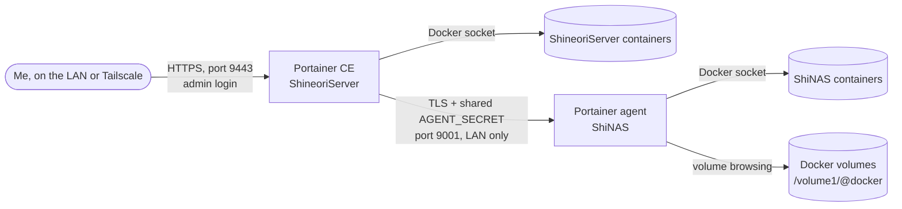

# Portainer

> One web UI to start, stop, restart and inspect containers on both of my servers, so I don't have to open an SSH session for every small change

| | |
|---|---|
| **Host** | ShineoriServer (server + UI) + ShiNAS (agent) |
| **Category** | Infrastructure |
| **Status** | 🟢 running |
| **Exposed?** | LAN and Tailscale only, HTTPS on port `9443`. The agent listens on port `9001`, bound to the NAS's LAN IP. Never published through Cloudflare. |
| **Version** | Portainer CE `2.45.4` (LTS) and agent `2.45.4`, pinned by tag |

Compose files: [`stacks/portainer/`](https://github.com/shineori/homelab/tree/main/stacks/portainer) and [`stacks/portainer-agent/`](https://github.com/shineori/homelab/tree/main/stacks/portainer-agent)
Upstream: [portainer/portainer](https://github.com/portainer/portainer)

## Why I run it

Most of my day-to-day container work is small: restart something, check a container's status, look at its environment or open a shell. Each of those meant working out which server the container lives on, SSHing in and typing the command. [Dozzle](dozzle.md) already solved this for logs, but it's read-only on purpose.

Portainer gives me the control side in one place: both servers in one dashboard, with containers, images, volumes, networks and stacks. It's also good practice for the Docker concepts I'm learning, because I can see how everything connects.

My compose files in `~/docker` are still the source of truth. I use Portainer for quick actions and inspection, not to redeploy stacks.

## Architecture



| Piece | Job |
|---|---|
| `portainer` | The web UI, the admin login and Portainer's database. Manages this server through the local socket and the NAS through the agent |
| `portainer-agent` | Gives Portainer access to the NAS's Docker API. It has no web UI |
| `.env` (both hosts) | `AGENT_SECRET`, a random 64-character value that both sides must share |
| `data/` | Portainer's database: users, settings and the list of environments |

## Security decisions

| Decision | Why |
|---|---|
| LAN and Tailscale only, never Cloudflare | Portainer can create, delete and exec into any container on both servers. That's root-level control of my whole homelab, so it shouldn't have a public address at all |
| Only port `9443` published | `9000` is plain HTTP, and `8000` is only for Edge agents, which I don't use. Fewer open ports means less to defend |
| Skipped Edge Compute | Edge is for machines Portainer can't reach directly. Both of my servers are on the same LAN, so a direct agent is simpler and needs no reverse tunnel |
| `AGENT_SECRET` on both sides | Without it, the agent accepts the first Portainer instance that connects to it. Anyone on my LAN who found port `9001` could take over the NAS's Docker. With the secret, the agent only answers my Portainer |
| Secret generated on the server with `openssl rand -hex 32`, kept in `chmod 600` files | It never appeared on screen or in my shell history, and I checked that both copies match by comparing checksums, not by printing them |
| Agent bound to the NAS's LAN IP | It doesn't need to listen on Tailscale or any other interface |
| Image pinned to an exact LTS tag | Same as my other services: [Diun](diun.md) tells me about new versions and I update on purpose, after reading the release notes |
| `no-new-privileges` | Cheap hardening. The Docker socket is still root-equivalent, so this limits the blast radius rather than removing the risk |
| Admin created right away | Portainer locks its first-run setup after 5 minutes, so nobody else on the network can claim the admin account before I do |

## Setup notes

1. **Server (ShineoriServer)**, in `~/docker/portainer`:
   ```bash
   mkdir -p data
   umask 077; echo "AGENT_SECRET=$(openssl rand -hex 32)" > .env
   docker compose up -d
   ```
2. **Create the admin user** at `https://<SERVER_IP>:9443` within 5 minutes of starting (or `docker restart portainer` to reopen the window). The password goes in my password manager. On the Edge Compute screen, click **Skip**.
3. **Agent (ShiNAS)**, in `~/docker/portainer-agent`: copy the same `.env` over SSH (`ssh server cat .env | ssh nas 'umask 077; cat > .env'`), then make sure the file has no Windows line endings (`sed -i 's/\r$//' .env`) and that the checksums match on both hosts.
4. Find the NAS's Docker data folder with `docker info --format '{{.DockerRootDir}}'` and mount its `volumes/` folder into the agent. On my NAS it's `/volume1/@docker`, not the usual `/var/lib/docker`.
5. `docker compose up -d` on the NAS, then check that the server can reach the agent: `timeout 3 bash -c '</dev/tcp/<NAS_IP>/9001'`.
6. In Portainer: **Environments → Add environment → Docker Standalone → Agent**, name `ShiNAS`, address `<NAS_IP>:9001`. I also renamed the `local` environment to `ShineoriServer`.

The server and agent should stay on the same version, so I update them together.

Portainer's `data/` folder goes in the nightly ShineoriServer backup, and the container is paused for a few seconds during the snapshot like my other small database apps, so its database is copied in a consistent state. The agent holds nothing but the secret, which is also on the server, so it doesn't need its own backup.

## Troubleshooting log

| Symptom | Cause | Fix |
|---|---|---|
| `permission denied while trying to connect to the docker API` on the NAS | My user had been dropped from the `docker` group. The group existed but was empty, most likely reset by a NAS system update | `sudo usermod -aG docker <user>`, then a fresh SSH login |
| `ls /var/lib/docker/volumes`: no such file or directory on the NAS | The NAS keeps Docker's data somewhere else | `docker info` showed the real data root, `/volume1/@docker`, and I mounted that instead |
| `scp` to the NAS failed with `No such file or directory` | SFTP paths on the NAS don't match the real home folder (the same thing happened with [Dozzle](dozzle.md)) | Used absolute paths, and piped the secret through `ssh ... cat` |
| The copied `.env` was 1 byte bigger on the NAS | Piping through Windows PowerShell added a carriage return to the line, which would have made the secrets not match | Stripped it with `sed -i 's/\r$//' .env` and compared checksums again |

## What I'd harden next

- [ ] Single sign-on through Authentik with OAuth, so Portainer uses my existing identity provider (Portainer CE supports OAuth)
- [ ] Limit port `9001` on the NAS to the server's IP with a firewall rule
- [ ] Turn on Portainer's two-factor authentication for the admin account until SSO is in place
- [ ] An Uptime Kuma monitor for the UI and the agent port, plus a Homepage tile
- [ ] Decide whether stacks deployed from Portainer are ever allowed, or keep compose files in `~/docker` as the only source of truth

## What I learned

- Control and visibility are different risks. Dozzle only reads logs, so it could go behind Cloudflare Access. Portainer can change anything, so it stays off the internet entirely.
- Without a shared secret, an agent trusts whoever connects first. Authentication has to be set up on both ends, not just on the UI.
- Not every NAS keeps Docker in `/var/lib/docker`. `docker info` tells you where it really is, instead of guessing.
- Line endings matter when a secret crosses from Windows to Linux. Comparing checksums caught a mismatch that would have looked like a "wrong password" error later.
- System updates can quietly undo manual setup like group membership, so it's worth checking after every update.
