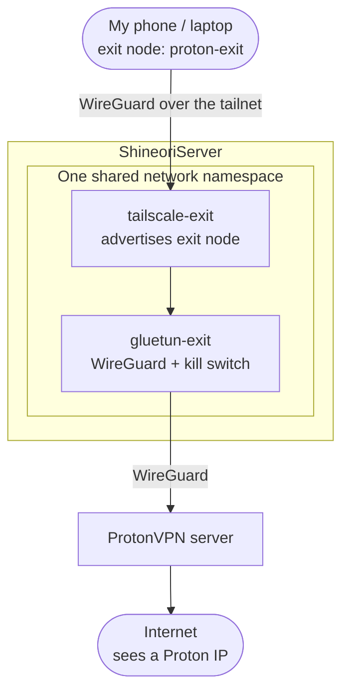

# Proton exit node

> A Tailscale exit node that sends its traffic out through ProtonVPN, so I get Tailscale's convenience and a consumer VPN's privacy from one toggle

| | |
|---|---|
| **Host** | ShineoriServer (Docker: Gluetun + Tailscale sharing one network namespace) |
| **Category** | Networking & monitoring |
| **Status** | 🟢 running |
| **Exposed?** | Tailnet only. Nothing is published, and the node has no LAN or internet path except through ProtonVPN |
| **Version** | `qmcgaw/gluetun:v3`, `tailscale/tailscale:stable` (Tailscale 1.104.4 at setup) |

Compose file: [`stacks/proton-exit/`](https://github.com/shineori/homelab/tree/main/stacks/proton-exit)

## Why I run it

I use [Tailscale](tailscale.md) to reach my own apps from anywhere, and I pay for ProtonVPN for privacy. On my phone I can only run one VPN at a time, so I kept having to pick: be on my tailnet, or be behind Proton.

This node removes that choice. With Tailscale on, I pick `proton-exit` as my exit node and:

- my private apps (Jellyfin, Karakeep, SearXNG and the rest) still work over the tailnet
- everything else leaves through a Proton server, so websites and whatever Wi-Fi I'm on see Proton, not my home IP

| Option | Why I did or didn't pick it |
|---|---|
| Switch between the two apps by hand | Annoying, and I'd forget to switch back |
| Use my server's normal Tailscale as an exit node | Hides my traffic from the local Wi-Fi, but websites would see my home IP. Not what I wanted |
| Run Proton on the host itself | Would push the whole laptop's traffic (Minecraft, Cloudflare Tunnel, everything) through Proton |
| **Separate Tailscale node inside a Gluetun container** ✅ | Only exit-node traffic goes through Proton, and the rest of the server is untouched |

## Architecture



- `tailscale-exit` uses `network_mode: service:gluetun-exit`, so it has **no network of its own**. Every packet it sends has to go through Gluetun.
- Gluetun's firewall blocks anything that isn't the Proton tunnel. If Proton drops, the exit node goes dark instead of leaking my home IP.
- It's a **separate tailnet node** (`proton-exit`) from the host's own Tailscale, which keeps serving my private apps with no change.
- Because the node only reaches the world through Proton, my devices usually can't connect to it directly and go through Tailscale's DERP relays instead.

## Security decisions

| Decision | Why |
|---|---|
| Tailscale inside Gluetun's namespace, not next to it | The kill switch covers the exit node too. No Proton tunnel means no traffic at all |
| A new, separate node instead of reusing the host's Tailscale | The host's node keeps its `tailscale serve` apps and single-address route. Using this node is opt-in per device |
| `TS_USERSPACE=true` | Userspace networking doesn't need its own firewall rules, so it can't fight with Gluetun's |
| `--accept-dns=false` | The node shouldn't take DNS settings from the tailnet. Gluetun handles DNS through the tunnel |
| WireGuard instead of OpenVPN for Proton | Faster and lighter. My [*arr stack](arr-stack.md) still uses OpenVPN because it needs port forwarding |
| Separate Gluetun from the *arr stack and SearXNG | One VPN going down or being restarted doesn't take the others with it |
| Keys only in `.env` (`chmod 600`), never committed | The Proton private key and Tailscale auth key are secrets. The repo only has a blank `.env.example` |
| Exit node had to be approved in the admin console | Tailscale makes exit nodes opt-in, so a container can't quietly become one on its own |
| Key expiry disabled for this node | It's a server that should stay logged in while I'm away from home |

## Setup notes

1. **Get the keys.**
    - Proton: account dashboard → Downloads → WireGuard configuration → Linux, pick a server. I only need the `PrivateKey` line.
    - Tailscale: admin console → Settings → Keys → generate an auth key (one-off is fine, it's only used for the first login).
2. **Create the stack** in `~/docker/proton-exit` with the compose file from this repo and a `.env`:
    ```bash
    WG_KEY=<proton private key>
    TS_KEY=<tailscale auth key>
    ```
    then `chmod 600 .env`.
3. **Start it and check Gluetun got a Proton IP:**
    ```bash
    docker compose up -d
    docker logs gluetun-exit | grep -i "public ip"
    docker logs --tail 20 tailscale-exit
    ```
4. **Approve the exit node:** admin console → Machines → `proton-exit` → Edit route settings → turn on **Use as exit node**. Then turn off key expiry for the machine.
5. **Use it:** in the Tailscale app → Exit node → `proton-exit`. Check an IP lookup site, which should show a Proton address.
6. If the advertise flag ever goes missing:
    ```bash
    docker exec tailscale-exit tailscale set --advertise-exit-node
    docker exec tailscale-exit tailscale debug prefs | grep -i advertise   # want 0.0.0.0/0 and ::/0
    ```

## Troubleshooting log

| Problem | Root cause | Fix |
|---|---|---|
| `proton-exit` showed as Connected on my phone, but the exit node list only had "None" | Advertising an exit node isn't enough. Tailscale needs an admin to approve it first | Approved "Use as exit node" for the machine in the admin console, and it showed up right away |

## What I'd harden next

- [ ] Pin both images to exact versions like the rest of the lab, so [Diun](diun.md) and my weekly update check can track them
- [ ] Add an [Uptime Kuma](uptime-kuma.md) check on Gluetun's health so I hear about it if Proton drops
- [ ] Write tailnet ACLs so only my own devices can use this exit node, not anything I share with friends
- [ ] Decide whether `ts-state` belongs in the nightly ShineoriServer backup, or if re-authing with a new key is easier
- [ ] Try a Proton server closer to home, or one with better throughput, if the DERP relay feels slow

## What I learned

- **`network_mode: service:<name>` is a cheap kill switch.** A container with no network of its own can only talk the way its host container lets it
- **Exit nodes are a two-sided deal.** The node advertises, the admin approves. Seeing it Connected doesn't mean it's usable as an exit node yet
- **Tailscale and a consumer VPN do different jobs.** Tailscale is about reaching *my* stuff, Proton is about hiding *me*. Chaining them gives both
- **Double tunnels cost speed.** With no direct path, traffic goes phone → DERP relay → server → Proton → internet. Fine for browsing, not ideal for big downloads
- **Keep VPN containers separate.** One shared Gluetun would be fewer containers, but separate ones fail separately
