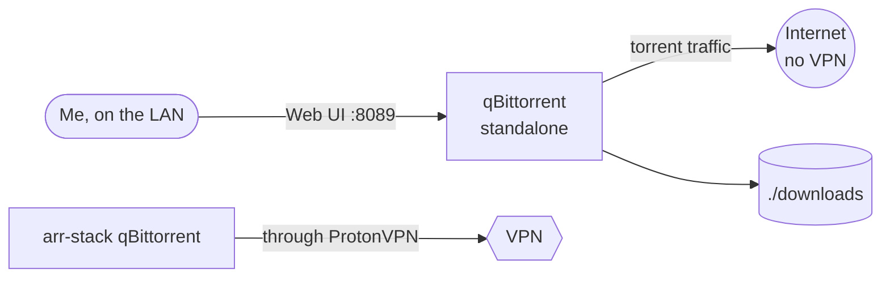

# qBittorrent (standalone)

> Separate qBittorrent instance with tracker-specific rules

| | |
|---|---|
| **Host** | ShiNAS |
| **Category** | Media |
| **Status** | ⏸️ on demand (started only when I need it) |
| **Exposed?** | Web UI LAN only (not published through the tunnel) |
| **Version** | `5.2.4_v2.0.15-ls479` (pinned) |

Compose file: [`stacks/qbittorrent-mam/`](https://github.com/shineori/homelab/tree/main/stacks/qbittorrent-mam)

## Why I run it

One private tracker I use for audiobooks **doesn't allow VPN connections**, so it can't share the VPN-routed client in my [*arr stack](arr-stack.md). Rather than weaken the VPN setup for everything else, this tracker gets its own small, separate qBittorrent.

## Architecture

Two clients, two rules: everything general goes through the VPN-protected stack, and only this one tracker uses the direct connection it requires.

## Security decisions

| Decision | Why |
|---|---|
| **Separate container, separate folders** | The no-VPN exception is contained to one client and one tracker |
| **Web UI LAN only** | Not published through the tunnel |
| **On demand** | Only running when I'm using it |
| **Pinned image** | Same version as the arr stack's qBittorrent |

## Setup notes

1. `docker compose up -d`, open `http://<LAN_IP>:8089`, change the default login
2. Add only that tracker's torrents here
3. Point the downloads folder at where Audiobookshelf can pick them up, or move them by hand

## Troubleshooting log

| Date | Problem | Root cause | Fix |
|---|---|---|---|
| — | Port mappings were wrong at first | The published ports didn't line up with what qBittorrent was set to use | Corrected the mappings during setup |

## What I'd harden next

- [ ] **Check the torrent port:** the compose sets `TORRENTING_PORT=6882` but publishes `51820`. Confirm which port qBittorrent actually listens on (Settings → Connection) and make the two match.
- [ ] Use the lab's usual `PGID=100` and local time zone, like the other stacks

## What I learned

- **Rules shape architecture:** one tracker's policy is why there are two download clients, and that's better than a single compromise
- **Inside vs outside ports:** what the app listens on and what Docker publishes have to line up, or connections silently fail
