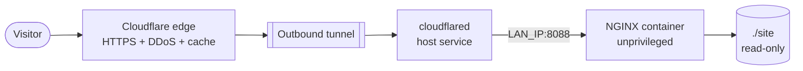

# Terminal resume site

> Interactive terminal-style resume served from NGINX in Docker

| | |
|---|---|
| **Host** | ShiNAS |
| **Category** | Web |
| **Status** | 🟡 in progress <!-- 🟡 in progress / 🔵 planned / ⚫ retired --> |
| **Exposed?** | Cloudflare Tunnel → `http://<LAN_IP>:8088` (port bound to the NAS's LAN IP) |

Compose file: [`stacks/resume-site/`](https://github.com/shineori/homelab/tree/main/stacks/resume-site)

## Why I run it

A resume that's also a demo. Instead of a PDF, visitors type commands (`help`, `whoami`, `projects`, `skills`, `contact`, `resume`) into a fake terminal, or tap buttons on a phone. Hosting it myself proves the skills it lists: Docker, NGINX, container hardening and Cloudflare.

## Architecture

### Who does what

| Piece | Job | What it can't do |
|---|---|---|
| **Cloudflare edge** | HTTPS certificate, DDoS protection, caches CSS/JS/PDF, hides my home IP | Store the site (if the NAS is off, pages don't load) |
| **cloudflared** | Carries requests over an outbound tunnel to `<LAN_IP>:8088`, so no router ports are open | Read files from disk; it only forwards HTTP |
| **NGINX** | The web server: maps URLs to files, sets security headers, blocks hidden files | Anything outside its container (read-only, no capabilities) |

**Why not one big reverse proxy for every site?** The tunnel already *is* the single front door: it routes each hostname to the right port. Each site keeps its own small NGINX as a plain web server (about 5 to 10 MB of RAM), so one site's config can never break another. Adding a shared proxy behind the tunnel would just be a second front door behind the first.

## Security hardening

| Control | Setting | Why |
|---|---|---|
| Non-root | `nginxinc/nginx-unprivileged` image, listens on 8080 | A compromised process isn't root |
| Read-only container | `read_only: true` + `tmpfs: /tmp` | Nothing can be written or planted, except scratch files in RAM |
| No capabilities | `cap_drop: ALL` | Removes every Linux privilege NGINX doesn't need |
| No escalation | `no-new-privileges:true` | Blocks setuid tricks inside the container |
| **Port bound to one address** | `<LAN_IP>:8088:8080` | Listens only on the NAS's LAN address, not on every interface. The tunnel route points here. **Trade-off:** devices on my home network can also reach it directly (see below). |
| Read-only files | `./site` mounted `:ro` | NGINX can serve the site but never change it |
| Hide version | `server_tokens off` | Less information for recon |
| Security headers | `nosniff`, `X-Frame-Options: DENY`, `Referrer-Policy`, `Permissions-Policy` | Blocks MIME sniffing, clickjacking and sensor access |
| Strict CSP | Own files + Google Fonts only, no inline scripts | Injected scripts (XSS) won't run |
| Hidden files | `location ~ /\. { deny all; }` | `.git` or `.env` can never leak |

**Where the port listens, and why it matters:** Docker publishes ports on **every interface** (`0.0.0.0`) by default, and its iptables rules skip host firewalls like `ufw`. I first bound the port to `127.0.0.1`, which makes the tunnel the only way in. I've since bound it to the NAS's **LAN IP** instead, so the tunnel route points at that address.

| Binding | Who can reach the site directly | Tunnel route must point at |
|---|---|---|
| `"8088:8080"` (Docker default) | Every interface: LAN, Docker networks, VPNs | any address |
| `"<LAN_IP>:8088:8080"` ← **current** | Devices on my home network | `http://<LAN_IP>:8088` |
| `"127.0.0.1:8088:8080"` | Only the NAS itself, so the tunnel is the only way in | `http://localhost:8088` |

**To verify:** from another PC on the LAN, `curl http://<LAN_IP>:8088` returns the page (expected with the current binding), and the public URL loads through Cloudflare. Since the site is static, read-only and holds nothing private, direct LAN access is a small risk. It does mean my home network skips Cloudflare for this site.

## Setup notes

1. Put the files in `~/docker/resume-site/`: `site/` (HTML, CSS, JS, resume PDF), `nginx.conf` and `docker-compose.yml`.
2. `docker compose up -d`
3. Add a tunnel route in the Cloudflare dashboard: hostname → `http://<LAN_IP>:8088`. The route **must** use the same address the port is bound to: with a LAN-IP binding, `localhost:8088` gets connection refused.
4. Editing site files takes effect immediately (bind mount, no restart). Cloudflare caches `style.css` and `script.js`, so after changing them, add or bump a version in `index.html` (`script.js?v=2`) or purge the cache in the Cloudflare dashboard, so visitors get the new version.

## Mobile support

The layout already had a phone breakpoint. I tested every command at iPhone SE size (375px) with Playwright: no horizontal overflow and no JS errors. But a code review turned up real-phone problems that a desktop emulator doesn't show:

| Problem on a real phone | Fix |
|---|---|
| iOS Safari **zooms the whole page** when you tap a text input smaller than 16px (the prompt was 13.5px) | Prompt input is 16px on phones |
| Every quick-command button called `input.focus()`, so **the keyboard slid up and covered the output** | Only focus on devices with a mouse: `matchMedia("(pointer: coarse)")` |
| The `autofocus` attribute could pop the keyboard open on page load (Android) | Removed it; the script focuses the prompt only on desktop |
| Quick-command buttons wrapped to **3 rows** on small phones | One swipeable row: terminal height went from 373px to 461px (**+24%**) |
| `height: 100%` doesn't account for Safari's toolbar | `100dvh` on phones (the actually visible height) |

Desktop behaves exactly as before.

## Troubleshooting log

| Date | Problem | Root cause | Fix |
|---|---|---|---|
| 2026-10-11 | Site reachable on every interface, skipping Cloudflare | Docker binds published ports to `0.0.0.0` by default | Bound the port to `127.0.0.1` at first. It's now bound to the NAS's LAN IP, with the tunnel route pointing at that address (see the binding table above). |
| 2026-10-11 | Tapping the prompt on an iPhone zoomed the page | iOS auto-zooms inputs under 16px | 16px input font on phones |
| 2026-10-11 | Keyboard covered the output after tapping a command button | Button handler always called `input.focus()` | Skip focus on touch devices |

## What I learned

- **Tunnel vs web server:** `cloudflared` delivers requests, NGINX answers them. They're different jobs, and you need both.
- **Docker's port defaults are wide open.** `"8088:8080"` means every interface, and Docker's iptables rules skip host firewalls. Bind to `127.0.0.1` when only a local proxy needs access.
- **Defense in depth:** Cloudflare at the edge, a port bound to one address, a locked-down container, then security headers. Each layer still holds if another one fails.
- **Port binding and tunnel route go together:** the route has to point at the exact address the port listens on, and that choice decides who can skip the tunnel.
- **Emulators catch layout, not behavior.** Automated phone-size tests passed, but iOS zoom and virtual-keyboard problems only show up on real devices, or by knowing to look for them.
- **Cache busting:** Cloudflare caches static files, so versioned URLs (`style.css?v=2`) make sure visitors get updates.
