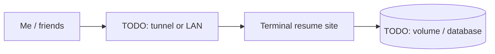

# Terminal resume site

> Interactive terminal-style resume served from NGINX in Docker

| | |
|---|---|
| **Host** | ShiNAS |
| **Category** | Web |
| **Status** | 🟡 in progress <!-- 🟡 in progress / 🔵 planned / ⚫ retired --> |
| **Exposed?** | TODO: LAN only / Cloudflare Tunnel / playit / Tailscale |

Compose file: [`stacks/resume-site/`](https://github.com/shineori/homelab/tree/main/stacks/resume-site)

## Why I run it

TODO: one or two sentences. What problem does this solve for you?

## Architecture

## Setup notes

- Status: in progress
- Planned: published via Cloudflare

TODO: the steps you'd need to rebuild this from scratch.

## Troubleshooting log

| Date | Problem | Root cause | Fix |
|---|---|---|---|
| TODO | | | |

## What I learned

TODO: the skill this proves (great for interviews).
