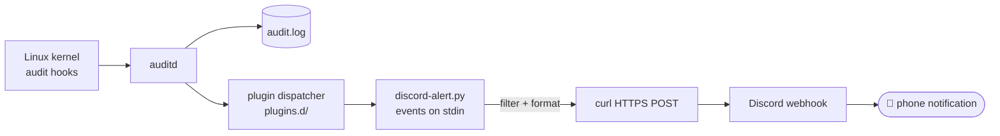

# auditd + Discord alerts

> Kernel-level audit logging on the NAS, with real-time alerts to my phone through Discord

| | |
|---|---|
| **Host** | ShiNAS |
| **Category** | Security & identity |
| **Status** | 🟢 running |
| **Exposed?** | No. Outbound-only (HTTPS to Discord) |

Code and rules: [`security/auditd/`](https://github.com/shineori/homelab/tree/main/security/auditd)

## Why I run it

My NAS runs a lot of services, and some are reachable from the internet. If something ever got in, I wanted to know **when it happened, not weeks later**. Logs only help if someone reads them, so I built a pipeline that watches the files attackers go after and pings my phone the moment one is touched.

## How it works

**auditd** is the Linux audit daemon. The audit hooks live in the kernel itself, so every file write or program execution that matches a rule gets recorded with *who*, *what*, *when* and *which program*. It's the same tool behind compliance standards like PCI-DSS and HIPAA.

The script isn't a cron job and doesn't poll the log file. It's registered as an **auditd plugin** (`discord.conf`), so auditd **streams each event into the script's standard input the instant it happens**. That makes it truly real-time, with no polling delay.

## What it watches

Each rule is tagged with a key, and the key decides which alert fires. Together, the rules cover three classic attacker goals: persistence, privilege escalation and covering tracks.

| Key | Watches | Trigger | Catches |
|---|---|---|---|
| `identity` | `/etc/passwd`, `/etc/shadow`, `/etc/group` | write / attribute change | Backdoor accounts, password-hash tampering, sneaking a user into a group |
| `auth_log` | `/var/log/auth.log`, `/var/log/faillog` | write / attribute change | Attackers editing logs to cover their tracks |
| `priv_esc` | `/bin/su`, `/usr/bin/sudo` | execute | Anyone becoming root |
| `sshd_config` | `/etc/ssh/sshd_config` | write / attribute change | Weakening SSH (enabling root login or passwords) |
| `cron_changes` | `/etc/crontab` | write / attribute change | Persistence: malware scheduling itself to run again |
| `sudoers` | `/etc/sudoers` | write / attribute change | Quietly granting permanent root |

**The rules are immutable.** The rules file ends with `-e 2`, which locks the audit configuration once it's loaded. Nobody, not even root, can change or delete the rules without rebooting the machine. So an attacker can't quietly switch off the monitoring, and a reboot to get around it is noisy in itself.

### Activity at time of writing

From `aureport -k --summary`:

| Key | Events |
|---|---|
| `priv_esc` | 51 |
| `auth_log` | 29 |
| `identity`, `sudoers`, `sshd_config`, `cron_changes` | **0** |

That's a quiet, healthy server: routine admin activity (my own `sudo` use and logins), and **zero hits on the high-severity rules**.

## Setup notes

1. Install auditd: `sudo apt install auditd`
2. Put the rules in `/etc/audit/rules.d/audit.rules` (see [`audit.rules`](https://github.com/shineori/homelab/blob/main/security/auditd/audit.rules))
3. Put the script at `/etc/audit/discord-alert.py` and lock it down: `sudo chown root:root` + `sudo chmod 700` (it contains the webhook URL)
4. Register it as a plugin in `/etc/audit/plugins.d/discord.conf` (see [`discord.conf`](https://github.com/shineori/homelab/blob/main/security/auditd/discord.conf))
5. Restart: `sudo systemctl restart auditd`. Because of `-e 2`, any later rule change needs a reboot.
6. Test it: run `sudo -v` and a "Sudo/Priv Esc Used" alert should land in Discord within seconds.
7. Check it: `sudo auditctl -l` (active rules), `sudo aureport -k --summary` (counts), `sudo ausearch -k identity -i` (details).

## Troubleshooting log

| Problem | Root cause | Fix |
|---|---|---|
| Alerts weren't reaching Discord | Sending the webhook request with Python's `urllib` failed | Switched the sender to call `curl` |
| Alert spam | A file-integrity rule on the Terraria server's data folder fired on every world save and runtime write | Removed that rule. Watching data an app rewrites constantly drowns out real events. |
| Noise from rule loading and system daemons | auditd logs its own rule loading at startup, and daemons generate events with no login user | Filter in the script: skip `CONFIG_CHANGE / add_rule` events and events with an unset login ID (`auid=4294967295`) |

## What I'd harden next

Reviewing my own code with a security eye:

- [ ] **The webhook URL is passed to `curl` as a command-line argument.** While `curl` runs, any local user can read process command lines with `ps`, so the secret briefly leaks. Fix: hand it to curl over stdin (`curl -K -`), or send the request from Python with a proper `User-Agent` header.
- [ ] **The noise filter is also a blind spot.** Skipping events with no login ID (`auid=4294967295`) hides daemon noise, but it would also hide a **compromised service or container** editing `/etc/passwd`, because those have no login ID either. Fix: only apply that filter to low-severity keys, and always alert on `identity`, `sudoers` and `sshd_config`.
- [ ] **Failed sends are silently ignored.** If Discord is down, the alert is lost. Fix: check curl's exit code and log failures locally.
- [ ] Show usernames instead of numeric IDs (resolve `auid` with Python's `pwd` module).
- [ ] Use Discord embeds so the severity colors already defined in `TRIGGERS` actually show up.
- [ ] Remove the unused `homedir_changes` trigger, or add the rule it was meant for.
- [ ] Add watches for `~/.ssh/authorized_keys` and the Docker config. Both are favorite persistence spots.

## What I learned

- **Kernel-level auditing:** watch rules, permission filters (`-p wa` / `-p x`), keys, and making rules immutable with `-e 2`
- **auditd's plugin system:** streaming events into my own code instead of polling log files
- **Alert tuning:** the hardest part of detection isn't catching events, it's keeping alerts meaningful. Removing the Terraria rule taught me that a noisy alert is a broken alert.
- **Thinking like an attacker about my own defenses:** every filter that reduces noise can also hide something, and every secret has to live *somewhere*.
- **Mapping detections to attacker goals:** persistence, privilege escalation, defense evasion (the MITRE ATT&CK way of thinking)
