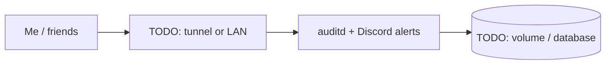

# auditd + Discord alerts

> Host-level audit logging with real-time Discord webhook alerts

| | |
|---|---|
| **Host** | ShiNAS |
| **Category** | Security & identity |
| **Status** | 🟢 running <!-- 🟡 in progress / 🔵 planned / ⚫ retired --> |
| **Exposed?** | TODO: LAN only / Cloudflare Tunnel / playit / Tailscale |

Not a Docker stack (see setup notes below).

## Why I run it

TODO: one or two sentences. What problem does this solve for you?

## Architecture

## Setup notes

- auditd rules on ShiNAS feed a Python alerting script that posts to a Discord webhook
- Debugged Python urllib issues in the webhook sender
- Tuned rules to stop alert spam from the Terraria server's runtime writes

TODO: the steps you'd need to rebuild this from scratch.

## Troubleshooting log

| Date | Problem | Root cause | Fix |
|---|---|---|---|
| TODO | | | |

## What I learned

TODO: the skill this proves (great for interviews).
