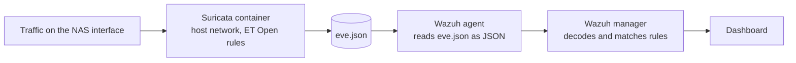

# Suricata (network IDS)

> A network intrusion detection system that watches raw packets on the NAS, so I can catch attacks that never touch a log file, like a port scan.

| | |
|---|---|
| **Host** | ShiNAS (Docker) |
| **Category** | Security & identity |
| **Status** | 🟢 running <!-- 🟡 in progress / 🔵 planned / ⚫ retired --> |
| **Exposed?** | No. Sniffs the NAS's own interface; only reaches out to fetch rule updates |
| **Feeds into** | [Wazuh SIEM lab](wazuh.md), through its `eve.json` alert file |

Stack notes: [`stacks/suricata/`](https://github.com/shineori/homelab/tree/main/stacks/suricata)

> 🧭 I built this to close a specific gap I found while testing my SIEM: my host-based Wazuh agent barely noticed a port scan. The full story is in [Wazuh detection validation](wazuh-detection-validation.md).

## Why I run it

My Wazuh agent is **host-based**: it reads log files on the machine. When I scanned the NAS from a Kali VM during my detection test, the agent hardly reacted, because a port scan is network traffic that mostly never gets written to any log. Suricata reads the actual **packets** off the wire, so it sees the scan. It then feeds its alerts into Wazuh, so everything still lands in one dashboard instead of a second tool to check.

## Architecture

| Piece | Job |
|---|---|
| **Suricata** | Sniffs the NAS's network interface and matches packets against rules |
| **ET Open ruleset** | About 53,000 community detection rules (Emerging Threats), scan rules included |
| **local.rules** | My own rule: flag any source that sends 30+ SYN packets in 60 seconds (a port scan) |
| **eve.json** | Suricata's alert output, one JSON record per line |
| **Wazuh agent** | Reads `eve.json` and ships the alerts to the manager, which already knows the Suricata format |

## Security decisions

| Decision | Why |
|---|---|
| **Runs in Docker, not apt-installed** | The NAS's package system is in a broken state, so Docker sidesteps `apt` entirely |
| **Host network + NET_ADMIN / NET_RAW** | Sniffing the real interface needs the host's network and raw-packet permissions |
| **Watches only the NAS's own interface** | A host-based IDS sees traffic to and from the NAS. Watching all devices would mean sniffing at the router |
| **Added a custom SYN-threshold rule** | The default ET SCAN rules assume an attacker **outside** the network, so they ignore an internal host scanning laterally. My rule catches the behaviour regardless of direction |
| **Noise tuned out at the SIEM** | Suricata floods "Ethertype unknown" decoder events from the NAS's Docker bridges; a Wazuh rule mutes just that one signature so real alerts stand out |

## Setup notes

1. Find the NAS's main network interface (`ip -o -4 route show to default`).
2. Create the stack: a compose file with `network_mode: host`, the `NET_ADMIN` / `NET_RAW` / `SYS_NICE` capabilities, volumes for logs and rules, and `command: -i <iface> -s /var/lib/suricata/rules/local.rules`.
3. Fetch the ruleset: `docker compose run --rm suricata suricata-update` (pulls ET Open).
4. Add my custom scan rule to `lib/rules/local.rules` (see the stack folder).
5. Start it: `docker compose up -d`, then confirm "Engine started" on the interface and that `eve.json` is growing.
6. Wire it into Wazuh: on the agent, add a `<localfile>` with `<log_format>json</log_format>` pointing at the `eve.json` path, then restart the agent.
7. Mute the decoder noise: a Wazuh local rule (level 0) that matches the "Ethertype unknown" signature only.

## Troubleshooting log

| Date | Problem | Root cause | Fix |
|---|---|---|---|
| 2026-11-16 | `docker` needed `sudo` on the NAS | My user's docker-group membership hadn't taken effect in that shell session | Used `sudo`; a fresh login clears it |
| 2026-11-16 | The scan produced hundreds of Suricata alerts, all "Ethertype unknown", none about the scan | Suricata on a Docker host sees lots of odd layer-2 frames from the bridges; and the default ET SCAN rules only fire for external→internal traffic, so my internal Kali was ignored | Wrote a custom SYN-threshold rule to catch the scan behaviour regardless of direction, and muted the ethertype noise at the SIEM |
| 2026-11-16 | Couldn't tell if the mute worked, the count still showed hundreds | The time picker was on "Last 24 hours", showing pre-mute history | Narrowed to the last 15 minutes; a clean drop to zero confirmed new events are being dropped |

## What I'd harden next

- [ ] Pin the Suricata image to an exact version (Diun watches it) instead of `latest`
- [ ] Stop Suricata generating the ethertype decoder noise at the source, not just muting it at the SIEM
- [ ] Watch at the router instead of the NAS, so the IDS sees traffic between all devices (needs the planned NUC router)
- [ ] Add more custom rules and tune the ET categories to the services I actually run
- [ ] Keep an eye on RAM (about 450 MB); trim the ruleset if the NAS gets tight

## What I learned

- **A host agent and a network IDS see different things.** The agent reads logs; Suricata reads packets. Together they cover far more than either alone.
- **Default IDS rules watch the perimeter.** They expect the attacker to be external, so a machine already inside the LAN can scan laterally and slip past them. A behaviour-based rule (many SYNs from one source) catches that.
- **Scanners give themselves away at the app layer too.** The built-in ET rule caught Nmap by the User-Agent string in its HTTP probes, even though the network-pattern rules stayed quiet.
- **Raw IDS output is noisy.** Tuning (muting known junk) is what makes it usable. Alert fatigue is the real enemy, the same lesson my dashboards taught me.
- **The time picker is half of every hunt.** Narrowing the window is how you prove a change actually took effect.
