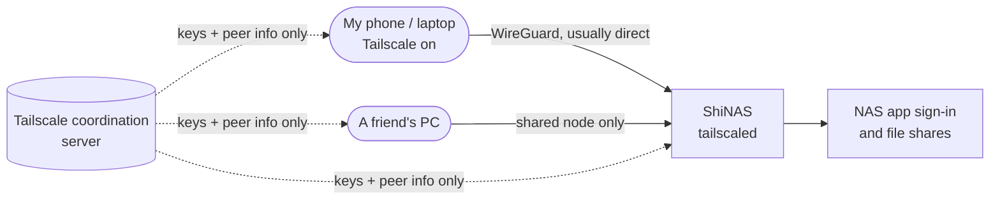

# Tailscale

> Private, encrypted remote access to the NAS from my own devices, plus one-off sharing with friends, without putting anything on the public internet

| | |
|---|---|
| **Host** | ShiNAS (installed from the package manager, runs as a host systemd service, not in Docker) |
| **Category** | Networking & monitoring |
| **Status** | 🟢 running |
| **Exposed?** | Tailnet only (my devices, plus machines I explicitly share) |
| **Version** | 1.104.4, updated by hand (auto-update can't work on this OS, see below) |

## Why I run it

After I put the NAS admin panel behind [Cloudflare Access](cloudflared.md), the NAS vendor's own desktop and phone app stopped being able to sign in through my public hostname. The app talks straight to the NAS API, so it has no way to complete a browser login through Access and Authentik, and it just reports "failed to connect".

I had three ways to get remote access back:

| Option | Why I did or didn't pick it |
|---|---|
| Cloudflare WARP + a private network route on my tunnel | Keeps Authentik as the gate, but everything goes through Cloudflare and needs more dashboard setup |
| The NAS vendor's own remote-access relay | Easiest, but my admin traffic would pass through the vendor's cloud |
| An Access "bypass" rule for the app | Rejected. It reopens the exact hole Access was added to close |
| **Tailscale** ✅ | Already installed on the NAS, traffic is usually direct device-to-device, and I can share *just the NAS* with a friend for big file transfers |

## Architecture



- The coordination server only hands out keys and tells devices how to find each other. My actual traffic goes peer to peer when possible, or through an encrypted relay when not.
- The NAS app signs in using the NAS's Tailscale address instead of my public hostname, so Cloudflare Access is never in the path.
- The [Cloudflare Tunnel](cloudflared.md) still handles public web apps. Tailscale is only for private access.

## Security decisions

| Decision | Why |
|---|---|
| Tailscale instead of an Access bypass | Remote access without weakening the Access policy on the admin panel |
| Share a single node with friends, not my whole tailnet | A friend can download from the NAS but can't see any of my other devices |
| Strong 2FA (passkey) on the account I sign into Tailscale with | With Tailscale, that login *is* the gate, so it has to be as strong as Authentik |
| Fixed the crash with a per-service systemd drop-in, not by editing the vendor's global config | The NAS OS owns `/etc/systemd/system.conf`. Its own services may rely on the setting, and an OS update could overwrite my change anyway |
| Installed the update with `dpkg` instead of `apt --fix-broken install` | The OS ships some of its own package builds on top of Debian. Letting apt "fix" them could break the NAS's web UI or file services |
| No `tailscale set --auto-update` on the NAS | It uses apt behind the scenes, which fails here. I update by hand during my weekly update check instead |

## Setup notes

1. Tailscale was already installed from the official apt repo and enabled as `tailscaled`.
2. Check it's up:
   ```bash
   systemctl is-active tailscaled
   tailscale status --self --peers=false
   ```
3. In the NAS app, sign in with the NAS's Tailscale address (or its MagicDNS name) instead of the public hostname.
4. To share with a friend: admin console → Machines → the NAS → Share. They accept the invite and only see that one machine.
5. **Updating on this NAS** (apt can't do it, see the troubleshooting log):
   ```bash
   cd /tmp
   apt-get download tailscale     # just downloads the newest .deb
   sudo dpkg -i tailscale_*.deb   # installs only Tailscale, no dependency solving
   rm tailscale_*.deb
   tailscale version              # client and daemon versions should match
   ```
6. The drop-in that keeps the daemon starting:
   ```ini
   # /etc/systemd/system/tailscaled.service.d/no-godebug.conf
   [Service]
   UnsetEnvironment=GODEBUG
   ```
   Then `sudo systemctl daemon-reload && sudo systemctl restart tailscaled`.

## Troubleshooting log

| Problem | Root cause | Fix |
|---|---|---|
| The NAS app said "failed to connect" after I added Cloudflare Access | The app can't complete a browser-based Access + Authentik login, so it only ever sees the Access login page | Use the LAN address at home, and Tailscale when away |
| Linking the NAS to the vendor's account kept failing with "Failed to operate" | Done through the public hostname, the request didn't make it through the Access/tunnel path (I first guessed it was unrelated and was wrong) | Did it from the LAN address instead, and it worked first try. Admin setup now happens on the LAN |
| `apt install --only-upgrade tailscale` refused with a wall of unmet dependencies | The OS mixes its own package builds (one was even an Ubuntu build) with Debian's, so apt wants to "fix" everything before installing anything | Downloaded only the Tailscale `.deb` and installed it with `dpkg -i`. Tailscale is a static binary, so it needs nothing else |
| After the update, `tailscale version` warned the client and daemon versions didn't match | The package updated the files, but the old daemon was still running from memory | Restart the service |
| The restart failed: `fatal error: removed GODEBUG "tlskyber" set to old value "0"`, exit code 2, five fast retries, then systemd gave up | The NAS OS sets `GODEBUG=tlskyber=0` for **every** service in `system.conf`. Newer Go versions removed that option and refuse to start when they see it. The old Tailscale was built with older Go, so it never cared. It ran fine when tested over SSH because my shell didn't load that setting | Added a drop-in with `UnsetEnvironment=GODEBUG` for `tailscaled` only, then `daemon-reload`, `reset-failed`, `restart`. Back up on 1.104.4 |

## What I'd harden next

- [ ] Add the same `UnsetEnvironment=GODEBUG` drop-in to `cloudflared` and `docker` *before* they get a newer-Go build. Otherwise an update would take down the tunnel or every container the same way
- [ ] Disable key expiry on the NAS node so it doesn't silently log out while I'm away from home
- [ ] Remove stale devices from the tailnet (several haven't been seen in 4 to 9 months)
- [ ] Write tailnet ACLs so shared friends can only reach the file-sharing ports, not the admin panel
- [ ] Put ShineoriServer back on the tailnet for remote access to its dashboards
- [ ] Consider removing the public NAS admin route entirely now that Tailscale covers remote admin

## What I learned

- **"Works in my shell" isn't "works as a service."** systemd gives services their own environment, and a vendor can inject variables into every one of them. Comparing my SSH test with the service's behavior is what pointed at the environment
- **Read the journal first.** The real error was one line in `journalctl`, while `systemctl status` only showed "exit code 2"
- **Vendor Linux isn't plain Debian.** On an appliance OS, apt's suggestions can be traps. Touch only the package you need, and leave system updates to the vendor's updater
- **Fix narrowly.** A drop-in for one service beats editing a global config I don't own, and it survives both OS and package updates
- **Zero Trust has side effects.** Putting a login wall in front of something can break the clients that talk to it, so plan a private access path alongside it
