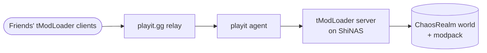

# Terraria (tModLoader)

> Modded Terraria server for friends, public via playit.gg

| | |
|---|---|
| **Host** | ShiNAS |
| **Category** | Game servers |
| **Status** | ⚫ retired |
| **Exposed?** | Was: playit.gg tunnel (no open ports) |
| **World** | ChaosRealm: Large, Master Mode, with a custom modpack |

Not a Docker stack (see setup notes below).

## Why I ran it

A modded Terraria world for my friends and me, running on my own hardware instead of someone's PC that had to stay on. I retired it when the group stopped playing, and kept the write-up for what it taught me about debugging.

## Architecture

## Security decisions

| Decision | Why |
|---|---|
| **playit.gg instead of port forwarding** | No open router ports, and my home IP stayed hidden |
| **Covered by auditd monitoring** | The NAS's [security monitoring](security-monitoring.md) watched the host the server ran on |

## Setup notes

1. Install the tModLoader dedicated server and build the modpack
2. Create a **Large, Master Mode** world (ChaosRealm)
3. Create a playit.gg tunnel to the server's port and share the playit address with friends
4. Retired: the world and modpack are kept, the server is stopped

## Troubleshooting log

| Date | Problem | Root cause | Fix |
|---|---|---|---|
| — | The server kept crashing | Traced through the logs to three specific mods: **TerrariaAmbience**, **TerrariaAmbienceAPI** and **PermaBuffs** | Removed those mods. Switched to vanilla temporarily while narrowing it down. |
| — | auditd flooded my Discord alerts | The server's normal runtime writes (world saves, logs) matched my file-watch rules | Tuned the audit rules to ignore the game server's expected writes, so real alerts stayed visible ([details](security-monitoring.md)) |

## What I learned

- **Debugging by elimination:** a crash log plus removing mods one group at a time found the exact culprits
- **Tuning security alerts:** rules that fire on normal activity bury the alerts that matter
- **Tunnels for game traffic** without exposing my home network
