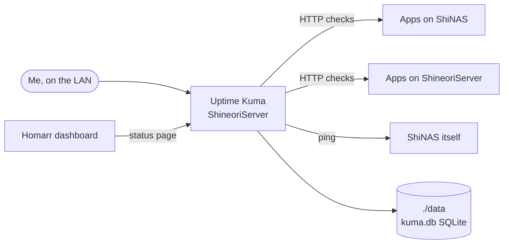

# Uptime Kuma

> Uptime monitoring and alerts for every service

| | |
|---|---|
| **Host** | ShineoriServer |
| **Category** | Networking & monitoring |
| **Status** | 🟢 running <!-- 🟡 in progress / 🔵 planned / ⚫ retired --> |
| **Exposed?** | LAN only |
| **Port** | 3001 |

Compose file: [`stacks/uptime-kuma/`](https://github.com/shineori/homelab/tree/main/stacks/uptime-kuma)

> 🚚 **Moved from ShiNAS to ShineoriServer** in October 2026 to free up RAM on the NAS. From there it watches the NAS **from the outside**, including a ping monitor for the NAS itself, so it can report when the NAS goes down instead of going down with it. Full story: [Moving services off the NAS](../infrastructure/migration.md).

## Why I run it

With services spread across two machines, I needed one place that tells me what's up, what's down, and since when, instead of finding out when an app doesn't load. Uptime Kuma checks every service every minute and keeps a history, so I can spot problems early and see patterns (like everything failing at the same moment).

## Architecture

| Piece | Job |
|---|---|
| **Monitors** | One HTTP check per web app, using the machine's LAN address (never `localhost`), plus a ping check for the NAS |
| **Tags** | Group related monitors, like the `arr` tag for the media-automation apps |
| **Status page** | A read-only page that [Homarr](homarr.md) reads to show live status on my dashboard |
| **`./data`** | Everything (settings, monitors, history) lives in one SQLite database in a bind-mounted folder |

## Security decisions

| Decision | Why |
|---|---|
| **LAN only** | It isn't published through the tunnel. It shows the layout of my whole lab, which doesn't need to be on the internet. |
| **Status pages are public by design** | Anyone who can reach the app can view a status page without logging in. That's fine on the LAN, but it's a reason to think before ever publishing it. |
| **Runs on a different machine than most of what it watches** | So a NAS outage gets reported instead of taking the monitor down too |
| **Image pinned to major version 2** | Updates within v2 only, no surprise major upgrade |

## Setup notes

1. `docker compose up -d` with `./data` mounted to `/app/data`
2. Create the admin account on first visit to `http://<LAN_IP>:3001`
3. Add monitors using **LAN IPs**, not `localhost` or container names, so they keep working no matter which machine Uptime Kuma runs on
4. Pause monitors for on-demand services (Flowcase, Ghiro) so only real outages show red
5. Create a status page for the Homarr widget
6. **Moving it:** stop the container first, then copy the folder. Stopping merges SQLite's write-ahead log (`kuma.db-wal`) into `kuma.db`, so the copy isn't half-saved.

## Troubleshooting log

| Date | Problem | Root cause | Fix |
|---|---|---|---|
| 2026-10-11 | *"Cannot connect to the socket server"* | Not Uptime Kuma itself: the whole NAS was overloaded by Immich ([diagnosis](immich.md#troubleshooting-log)), and Uptime Kuma ran on that same NAS | Fixed the overload, then moved Uptime Kuma to the other machine so it can report the next one |
| 2026-10-11 | 12 monitors red at once, burying anything real | Services I'd stopped on purpose (on-demand apps, things paused during the overload) still had active monitors | Paused monitors for services that are meant to be off |
| 2026-10-11 | Couldn't log in after the move | I'd forgotten the admin password | Reset it inside the container with `npm run reset-password`. Monitors and history are untouched. It's in my password manager now. |
| 2026-10-11 | Homarr's Uptime Kuma widget returned **404** | Homarr reads a *status page*, and with no slug set it asks for one called `default`, which didn't exist | Created a status page and gave Homarr its slug |

## What I'd harden next

- [ ] Discord notifications on the important monitors, so an outage reaches my phone
- [ ] A **push monitor** as a dead-man's switch for the nightly backup (alerts if the backup *doesn't run at all*)
- [ ] Monitors for NAS load and swap, to catch the next overload before apps time out

## What I learned

- **Monitoring belongs outside what it monitors.** When the NAS overloaded, the monitor running on it went down too instead of warning me.
- **Alert fatigue is real.** A dashboard with 12 expected reds hides the one unexpected red, so "intentionally off" needs to look different from "broken".
- **Design for moving:** monitors that use LAN addresses survived the move to a new machine without a single edit
- **SQLite's write-ahead log:** recent changes can live in a separate `-wal` file, so you stop the app before copying its database
