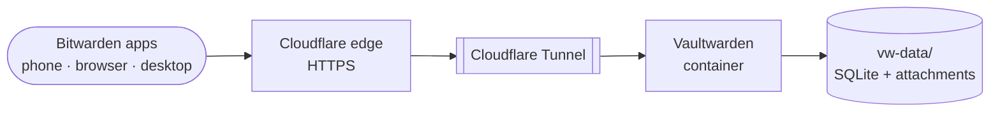

# Vaultwarden

> My own password manager server: passwords, TOTP codes and passkeys, under my control and portable across devices

| | |
|---|---|
| **Host** | ShiNAS |
| **Category** | Security & identity |
| **Status** | 🟢 running |
| **Exposed?** | Cloudflare Tunnel (no open ports) |
| **Version** | 2026.6.0 |

Compose file: [`stacks/vaultwarden/`](https://github.com/shineori/homelab/tree/main/stacks/vaultwarden)

## Why I run it

I wanted **every** credential (passwords, 2FA codes *and* passkeys) in one place that I control and can take with me. Passkeys in particular tend to get locked into one phone's ecosystem. If they live in my own Bitwarden-compatible vault instead, a new phone, or even a switch between iPhone and Android, can't strand them.

Vaultwarden is a lightweight, Rust-based server that speaks the Bitwarden API. So I get the official Bitwarden apps and browser extensions on every device, backed by a server running on my NAS.

## Architecture



### The security model: zero-knowledge

The most important thing about this service is what the server **can't** do:

```
📱 device:  master password → derives key → encrypts vault locally
                                                   │
                                                   ▼  only encrypted blobs travel
🗄️ server:  stores ciphertext it cannot read, plus a hash to check logins
```

Encryption and decryption happen **on my devices**. Vaultwarden only ever stores encrypted data. Even if someone stole the whole `vw-data/` folder, they'd still need my master password to read anything. Exposing it through the tunnel is a reasonable trade-off because of this. It's the same model Bitwarden's own cloud uses.

## Security decisions

| Decision | Why |
|---|---|
| **Invite-only registration** | Public sign-ups are off. Friends join through an invite to my Bitwarden organization, which also lets us share logins like the Wi-Fi password. Strangers who find the URL can't create accounts (see the troubleshooting log). |
| **Admin panel disabled** | No `ADMIN_TOKEN` is set, so `/admin` shows a "disabled" page and there's no admin login to brute-force |
| **Published through Cloudflare Tunnel** | No open router ports, home IP hidden, HTTPS at the edge |
| **Not behind Cloudflare Access** | The Bitwarden apps talk to the API directly and can't complete a browser login challenge. The vault's own encryption and master password are the protection here. |
| **Email through a dedicated homelab mailbox** | Invites, new-device login alerts and 2FA-by-email go out from a homelab-only Gmail account, never my personal email. It uses STARTTLS on port 587. |
| **A separate app password per service** | Vaultwarden has its own Gmail app password, not shared with Authentik, so if one leaks I can revoke it without breaking anything else |
| **SMTP secrets in a root-only `.env`** | Credentials live in `.env` (`chmod 600`, root-owned), loaded with `env_file`. The compose file holds no secrets, and the repo has a blanked `.env.example`. |
| **`DOMAIN` set to the public HTTPS URL** | Vaultwarden needs this for attachments and passkeys (WebAuthn) to work behind a proxy |

## Setup notes

1. Start the container: `docker compose up -d` (data persists in `./vw-data`)
2. Publish it through the tunnel and set `DOMAIN` to the public `https://` URL
3. Create my account, **then** set `SIGNUPS_ALLOWED: "false"` and recreate the container
4. **Email:** create a Gmail app password for the homelab alerts account and write the `SMTP_*` settings to a root-only `.env` (I read the password with `read -s` so it never appears on screen or in shell history). Add `env_file: .env` to the compose file, recreate the container, and test it with *Get master password hint*.
5. Create an **Organization** in the web vault and invite friends by email. They get a *Join organization* link and can register even though public sign-ups are off.
6. Point the Bitwarden apps at the self-hosted server URL (Settings → Self-hosted)
7. Import passwords, then move 2FA codes and passkeys in over time

## Troubleshooting log

| Problem | Root cause | Fix |
|---|---|---|
| **Public sign-ups were still open** on an internet-facing server. Found while documenting the setup. | `SIGNUPS_ALLOWED` stayed `"true"` after I created my account, even though the compose file's own comment says to turn it off | Switched to **invite-only**: `SIGNUPS_ALLOWED: "false"` with invitations still allowed. Recreated the container and verified from outside. |
| After the fix, the server's public config still reported registration as *not disabled* | That flag stays on while invitations are allowed, so invited users can still reach the sign-up page. It isn't proof that strangers can register. | Tested the real behavior instead: an uninvited address trying to start registration gets `400 Registration not allowed`. |

## What I'd harden next

- [ ] **Pin the image version** instead of `:latest`, and upgrade deliberately after reading the release notes (same approach as Authentik)
- [ ] **Automated, encrypted, off-NAS backups of `vw-data/`.** It's the most important data in the lab, because losing it means losing every login.
- [ ] **Keep an offline emergency kit:** master password plus the 2FA recovery code for my vault account, stored on paper somewhere safe
- [ ] Check the brute-force protections on the login endpoint, and alert on failed logins
- [x] **Configured SMTP** ✅ *Done:* invitations and new-device login alerts now arrive by email, sent through the lab's alerts mailbox with a dedicated app password

## What I learned

- **Zero-knowledge architecture:** why a password manager can be internet-facing when the server never holds decryption keys
- **The gap between "set up" and "secured":** a one-time step (closing sign-ups) is easy to forget once everything *works*. Auditing your own setup catches it.
- **Verifying from the attacker's side:** a status flag said one thing, but testing what a stranger can actually do said another. Behavior beats indicators.
- **Handling secrets during setup:** a password typed with `read -s` into a `chmod 600` file never touches the screen, my shell history, the compose file or git. I confirmed it was written correctly from the file size alone, without ever looking at it.
- **Passkey portability:** where credentials live matters as much as how strong they are
