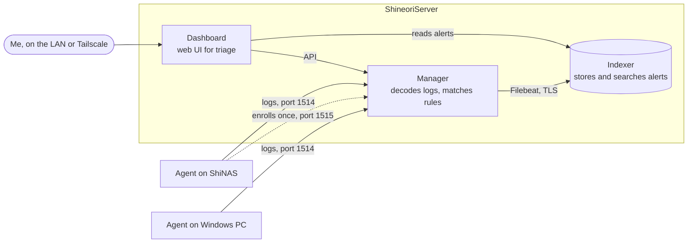

# Wazuh SIEM lab

> A SIEM that collects logs from my machines in one place, checks them against detection rules and shows me the alerts

| | |
|---|---|
| **Host** | ShineoriServer (server stack), ShiNAS and Windows PC (agents) |
| **Category** | Security & identity |
| **Status** | 🟡 in progress <!-- 🟢 running / 🔵 planned / ⚫ retired --> |
| **Exposed?** | LAN and Tailscale only. No public route, on purpose |
| **Ports** | 5601 (dashboard), 1514 and 1515 (agents), 55000 (manager API), 9200 (indexer API), 514/udp (syslog) |

Stack notes: [`stacks/wazuh/`](https://github.com/shineori/homelab/tree/main/stacks/wazuh)

> 🧭 **Where this is at (2026-11-16):** the server stack is up, all three default passwords are changed, two agents (the NAS and my Windows PC) are enrolled and showing as active, and my existing [auditd](security-monitoring.md) events from the NAS now arrive as Wazuh alerts. Still to do: attack my own lab, find the alerts, and write detection rules and incident reports. I only claim a skill here once the matching step is actually done.

## Why I run it

I want to work in a SOC, and the core tool there is a SIEM: one place that gathers logs from many machines, analyzes them and raises alerts for a person to triage. Reading about that isn't the same as running one, so I built my own.

My [auditd pipeline](security-monitoring.md) already watches one machine and pings my phone. Wazuh is the next step up: several machines, a searchable history, and rules I can write and test myself.

## Architecture

| Piece | Job |
|---|---|
| **Agent** | Small program on each monitored machine. Reads its logs, watches important files and ships events to the manager, encrypted |
| **Manager** | Decodes each log line, compares it to the rule set and turns matches into alerts |
| **Indexer** | A search database (an OpenSearch fork). Keeps the alerts so I can search and chart them |
| **Dashboard** | The website where I read and triage alerts |
| **Certificates** | A small private certificate authority made at install time. The three server parts use it to encrypt traffic and prove who they are to each other |

The journey of one log: something happens on the NAS, the agent ships it, the manager decodes it and checks the rules, a match becomes an alert, the indexer stores it and the dashboard shows it to me.

## Security decisions

| Decision | Why |
|---|---|
| **LAN and [Tailscale](tailscale.md) only** | A SIEM dashboard shows the inside of my whole lab. It has no reason to be on the internet |
| **All three default passwords changed before adding any agent** | Fresh installs ship with published default logins. I replaced the `admin`, `kibanaserver` and `wazuh-wui` passwords first, so no real data ever sat behind a default |
| **Three separate accounts stay separate** | Each part logs in to the others with its own account, so one stolen password doesn't hand over everything (least privilege) |
| **Passwords live in my password manager, and the compose file stays off this repo** | The upstream compose file holds passwords inline, so I document the stack instead of copying it here |
| **Server pinned to an exact version tag** | The compose files and images match, and I can say exactly what I ran |
| **Agent pinned to the same version and put on hold** | Wazuh only promises compatibility when the manager is the same version as the agent or newer, so a routine update must not push the agent ahead |
| **Agent package checked against Wazuh's signing key** | The agent runs with root-level access to my logs, so I want proof the package really came from Wazuh |
| **Did not "fix" the NAS's package system to get the agent on** | The suggested repair could have removed parts the NAS's own software depends on. I installed the one package directly instead (see the log below) |

## Setup notes

**Server (ShineoriServer)**

1. Pre-flight: check cores, RAM, disk and whether the needed ports are free (`nproc`, `free -h`, `df -h`, `ss -tulpn`). Wazuh asks for 4 cores, 8 GB of RAM and 50 GB of disk for this stack.
2. Check the kernel's memory-map limit: `sysctl vm.max_map_count`. The indexer needs at least 262144. Mine was already higher, so no change was needed.
3. Clone the official deployment repo at a pinned tag: `git clone https://github.com/wazuh/wazuh-docker.git -b v4.14.10 wazuh`, then work in `single-node/`.
4. Generate the certificates: `docker compose -f generate-indexer-certs.yml run --rm generator`
5. Change the dashboard's host port in `docker-compose.yml` from `443:5601` to `5601:5601` (443 was taken on my server).
6. `docker compose up -d`, then log in at `https://<LAN_IP>:5601`.
7. Change the three default passwords, one at a time, following Wazuh's guide. For the two indexer accounts: edit the compose file, make a hash with the indexer's `hash.sh` tool, put the hash in `config/wazuh_indexer/internal_users.yml`, restart, then load it with `securityadmin.sh`. For the API account: edit `config/wazuh_dashboard/wazuh.yml` and the compose file, then recreate the containers.
8. Test each account on its own instead of trusting the dashboard: `curl -k -u <user> https://localhost:9200` for the indexer accounts, and a token request to port 55000 for the API account.

**Agent (ShiNAS)**

1. Import Wazuh's signing key and add its apt repository.
2. Check the version on offer: `apt-cache policy wazuh-agent`
3. Download and install the pinned version, pointing it at the manager: `apt-get download wazuh-agent=4.14.10-1`, then `sudo WAZUH_MANAGER="<LAN_IP>" WAZUH_AGENT_NAME="ShiNAS" dpkg -i wazuh-agent_4.14.10-1_amd64.deb`
4. `sudo systemctl enable --now wazuh-agent`
5. Hold the version: `echo "wazuh-agent hold" | sudo dpkg --set-selections`
6. Verify from the server: `docker exec single-node-wazuh.manager-1 /var/ossec/bin/agent_control -l`

**Feeding in auditd (ShiNAS agent + manager)**

My audit rules are locked (`-e 2`), so the goal was to change nothing on the auditd side. auditd keeps writing its log and my Discord alerts keep firing. Wazuh just reads the same file.

1. The agent needs a `localfile` block with `log_format` set to `audit`, pointing at `/var/log/audit/audit.log`. That format stitches a multi-line audit event back into one event.
2. The manager needs to know my rule keys. Audit events all look alike, so Wazuh uses each rule's key plus a lookup list to tell a write from an execute. The list only ships with Wazuh's example keys, so I added mine to `/var/ossec/etc/lists/audit-keys` as `key:type` lines: `identity`, `auth_log`, `sshd_config`, `cron_changes` and `sudoers` as `write`, and `priv_esc` as `execute`.
3. Restart the manager so it rebuilds the list.
4. Test: run a `sudo` command on the NAS. Within seconds the manager logged rule 80789, "Audit: Watch - Execute access: /usr/bin/sudo", with my `priv_esc` key, the user, the terminal and the exact command.

## Troubleshooting log

| Date | Problem | Root cause | Fix |
|---|---|---|---|
| 2026-11-16 | The dashboard's default port (443) was taken, and so was my first replacement (8443) | Tailscale Serve was already publishing other apps on both ports. The pre-flight port check caught it before launch | Listed what Serve had claimed with `tailscale serve status`, confirmed 5601 was free and mapped the dashboard there |
| 2026-11-16 | Only 44 GB free, under the 50 GB guideline | Docker was holding about 7 GB of build cache plus untagged leftover images | `docker builder prune` and `docker image prune` freed about 21 GB. I did not run `prune -a`, because it would also delete images for stacks I keep switched off |
| 2026-11-16 | Adding the documented memory-map setting made things worse, not better | My system's default limit was already four times higher. The override file I added (and an older one I found) pulled it down | Deleted both override files so the higher default applies again. Lesson: read the current value before changing it |
| 2026-11-16 | Dashboard stuck on "Wazuh dashboard server is not ready yet" after a password change | The dashboard logs in to the indexer with its own service account. The indexer's log showed `Authentication finally failed for kibanaserver`: the hash on file had not been made from the password in the compose file | Made a fresh hash from the exact password, put it in the right block, reloaded with `securityadmin.sh` and confirmed with `curl -u kibanaserver` before touching the browser |
| 2026-11-16 | `apt` refused to install the agent on the NAS: "unmet dependencies" | The NAS runs a customized Debian whose package system was already in an inconsistent state, unrelated to Wazuh. `apt` won't install anything while that's true | Left the suggested `apt --fix-broken install` alone, since it could remove parts of the NAS's own software. Downloaded the signed package with `apt-get download` and installed just that one with `dpkg -i`. It only needed five basic packages that were already present |

## What I'd harden next

- [x] Confirm the NAS agent shows as active (done 2026-11-16)
- [x] Add the Windows PC as a second agent (done 2026-11-16, I set this one up on my own)
- [x] Feed my existing [auditd](security-monitoring.md) log into Wazuh, so those kernel-level events get rules and history too (done 2026-11-16)
- [ ] Decide what to do about `priv_esc` noise: it alerts on every `sudo`, including my own routine admin work
- [ ] Move the passwords out of the compose file into a `.env` file or Docker secrets
- [ ] Stop publishing the indexer API (9200) and manager API (55000) on every address. Agents only need 1514 and 1515
- [ ] Set an index retention policy, so alerts can't slowly fill the disk
- [ ] Add the Wazuh config and certificates to the nightly backup
- [ ] Give the dashboard a certificate my browser trusts instead of clicking past the warning
- [ ] Find out why the NAS's package system is inconsistent, in its own careful session
- [ ] Planned lab work: scan and brute-force my own lab from Kali, find the alerts, write a custom detection rule mapped to MITRE ATT&CK, and write a short incident report per attack

## What I learned

- **What a SIEM actually is:** agents collect, the manager decides, the indexer remembers, the dashboard shows. I can now explain each hop and which port it uses
- **Check before you change.** The port check saved me from a failed launch, and skipping the same habit on a kernel setting made me lower a limit I meant to raise
- **Containers share the host's kernel.** A kernel setting the indexer needs has to be set on the host, which is a real difference from a virtual machine
- **A hash is a fingerprint of one exact password.** One wrong character gives a completely different hash, and nothing warns you until logins fail
- **Triage from both sides.** The dashboard only said "error". The indexer's log named the exact account being rejected. Then testing that one account with `curl` proved the fix
- **Service accounts break things quietly.** Nobody types the `kibanaserver` password, so a mismatch shows up as "the app is down", not "wrong password"
- **`apt` plans, `dpkg` installs.** When the planner is stuck on unrelated problems, installing one well-understood package directly can be the safer move than a system-wide "fix"
- **Version rules matter between parts:** the manager has to be the same version as its agents or newer
